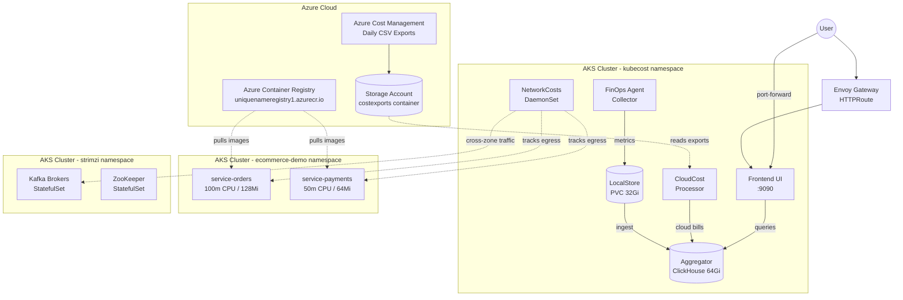

<p align="center">
  
  
  
  
  
  
  
  
</p>

# 💰 AKS Kubecost — Enterprise FinOps on Azure Kubernetes Service

A production-ready deployment of **Kubecost 3.3.0** on AKS with Azure billing integration, FinOps cost-allocation tagging, budget alerts, and demo microservices purpose-built to exercise Kubecost's right-sizing and efficiency dashboards.

> 🎯 **What this repo demonstrates:** End-to-end Kubernetes cost visibility — from Azure Service Principal setup and cloud billing ingestion, through per-namespace/per-label cost allocation, to budget thresholds that fire when your Kafka cluster exceeds $100/week.

---

## ✨ Key Features

| Feature | Description |
|---------|-------------|
| 🏗️ **Kubecost 3.x Architecture** | No Prometheus dependency — FinOps Agent collects metrics directly, ClickHouse-backed aggregator |
| ☁️ **Azure Cloud Integration** | Service Principal + Cost Management exports for out-of-cluster costs (VMs, disks, LBs) |
| 🏷️ **FinOps Label Mapping** | `cost-center`, `team`, `app`, `environment`, `owner` labels mapped to Kubecost allocation dimensions |
| 💵 **Budget Alerts** | $100/week threshold on the Strimzi namespace with 75% and 100% email notifications |
| 🌐 **Network Cost Attribution** | DaemonSet tracking cross-zone Kafka replication traffic (10.0.0.0/8 excluded from in-zone) |
| 🚪 **Gateway API (Envoy)** | Native HTTPRoute for external dashboard access on `kubecost.aks.mydomain.com` |
| 🧪 **Demo Microservices** | Two Flask apps with asymmetric resource allocations to test right-sizing recommendations |
| 📊 **API Test Suite** | Automated scripts querying Allocation, Assets, CloudCost, and Right-Sizing APIs |

---

## 🏛️ Architecture Overview



---

## 📋 Prerequisites

| Tool | Version | Install |
|------|---------|---------|
| `kubectl` | v1.28+ | [docs](https://kubernetes.io/docs/tasks/tools/) |
| `helm` | v3.12+ | [docs](https://helm.sh/docs/intro/install/) |
| `az` CLI | v2.50+ | [docs](https://learn.microsoft.com/en-us/cli/azure/install-azure-cli) |
| `jq` | v1.6+ | `apt install jq` / `brew install jq` |
| `curl` | any | pre-installed on most systems |
| Python | 3.10+ | only for local microservice development |

> 💡 **Tip:** Verify cluster access with `kubectl get nodes` before proceeding. The AKS cluster should be running Kubernetes v1.28+.

---

## 🚀 Quick Start

### Option A: Full Automated Deployment

```bash
git clone <repo-url> && cd aks-kubecost
./deploy-all.sh
```

### Option B: Step-by-Step

#### Step 1 — Create Namespace & Azure Credentials

```bash
# Create the kubecost namespace
kubectl apply -f 01-prerequisites/00-namespace.yaml

# Create Azure Service Principal + Storage Account for cost exports
bash 01-prerequisites/01-create-azure-sp.sh

# Source credentials and create the Kubernetes secret
source /tmp/kubecost-azure-credentials.env
bash 01-prerequisites/02-create-secret.sh
```

> 🔒 **Security:** The SP creation script saves credentials to `/tmp/kubecost-azure-credentials.env`. Delete this file after creating the K8s secret. Never commit credentials to git.

#### Step 2 — Configure Azure Cost Management Export

This is a **manual step** in the Azure Portal:

1. Navigate to **Cost Management** → **Exports**
2. Create a daily export of **Actual Cost**
3. Point it to the storage account created in Step 1
4. Set container to `costexports`, format CSV

> ⏳ First export data appears in 24-48 hours. In-cluster costs are visible immediately.

#### Step 3 — Install Kubecost 3.3.0

```bash
# Add the Kubecost 3.x Helm repo
helm repo add kubecost https://kubecost.github.io/kubecost/
helm repo update kubecost

# Install with production values
bash 02-kubecost-helm/install-kubecost.sh
```

#### Step 4 — Deploy Gateway (Optional)

```bash
# Requires Envoy Gateway with GatewayClass 'eg' installed
kubectl apply -f 04-gateway-route/gateway.yaml
```

#### Step 5 — Apply FinOps Labels to Strimzi

```bash
# Run after Strimzi Kafka is deployed
bash 03-cost-allocation/apply-finops-labels.sh
```

#### Step 6 — Deploy Demo Microservices

```bash
cd ../aks-microservices-kubecost
bash build-and-deploy.sh
```

---

## 🧪 Testing & Validation

### Access the Kubecost Dashboard

```bash
kubectl port-forward -n kubecost svc/kubecost-frontend 9090:9090
# Open http://localhost:9090
```

> 💡 **Remote access via SSH:** `ssh -L 9090:localhost:9090 ubuntu@<server-ip>`, then open `http://localhost:9090` locally.

### Test Microservice Endpoints

```bash
# Port-forward the services
kubectl port-forward -n ecommerce-demo svc/service-orders 8081:80 &
kubectl port-forward -n ecommerce-demo svc/service-payments 8082:80 &

# Health checks
curl -s http://localhost:8081/health | jq .
curl -s http://localhost:8082/health | jq .

# Get mock data
curl -s http://localhost:8081/orders | jq .
curl -s http://localhost:8082/payments | jq .

# Generate CPU/RAM load for Kubecost to measure
curl -X POST 'http://localhost:8081/stress?duration=30&threads=2&mem_mb=50'
```

### Query Kubecost Allocation API

```bash
# Cost by namespace
curl -s 'http://localhost:9090/model/allocation?window=1d&aggregate=namespace&accumulate=true' | jq .

# Cost by cost-center label
curl -s 'http://localhost:9090/model/allocation?window=1d&aggregate=label:cost-center&accumulate=true' | jq .

# Right-sizing recommendations
curl -s 'http://localhost:9090/model/savings/requestSizingV2?window=1d&filterNamespaces=ecommerce-demo' | jq .
```

### Run the Full Test Suite

```bash
cd aks-microservices-kubecost
bash test-kubecost-allocation.sh
```

---

## 🖥️ Dashboard Validation Checklist

| Step | Where in UI | What to Look For |
|------|-------------|------------------|
| 1 | **Allocations** → Namespace | `ecommerce-demo`, `strimzi`, `kubecost` with accumulated costs |
| 2 | **Allocations** → Label: `cost-center` | `digital-storefront` (ecommerce) and `data-platform` (Kafka) |
| 3 | **Allocations** → Controller | `service-orders` with higher efficiency vs `service-payments` |
| 4 | **Allocations** → Toggle "Show Idle" | `service-payments` shows high idle cost (overprovisioned) |
| 5 | **Budgets** | "Strimzi Kafka Weekly Budget" — $100/week with 75% and 100% actions |
| 6 | **Savings** → Request Right-Sizing | `service-payments` flagged for CPU and RAM reduction |
| 7 | **Assets** → Type | Node, Disk, LoadBalancer costs from Azure |

---

## ⚙️ Configuration Reference

### Kubecost Helm Values (`values-aks-production.yaml`)

| Section | Key Setting | Value | Purpose |
|---------|------------|-------|---------|
| `global` | `clusterId` | `aks-kubecost-prod` | Unique cluster identifier |
| `cloudCost` | `cloudIntegrationSecret` | `cloud-integration` | Azure billing secret reference |
| `localStore` | `persistentVolume.size` | `32Gi` | Agent ↔ Aggregator buffer |
| `aggregator` | `aggregatorDbStorage.storageRequest` | `64Gi` | ClickHouse analytics DB |
| `networkCosts` | `enabled` | `true` | Cross-zone Kafka traffic tracking |
| `networkCosts` | `config.destinations.in-zone` | excludes `10.0.0.0/8` | Forces cross-AZ as in-region |
| `kubecostProductConfigs` | `budgets.budgetsConfig[0].spendLimit` | `100` | $100/week strimzi threshold |

### FinOps Label Mapping

| Kubernetes Label | Kubecost Dimension | Example Value |
|------------------|--------------------|---------------|
| `app` | Product | `kafka`, `service-orders` |
| `team` | Team | `data-engineering`, `storefront-engineering` |
| `cost-center` | Department | `data-platform`, `digital-storefront` |
| `environment` | Environment | `production`, `staging` |
| `owner` | Owner | `platform-team`, `ecommerce-team` |

### Demo Microservices Resource Allocations

| Service | CPU Request | CPU Limit | RAM Request | RAM Limit | Purpose |
|---------|-------------|-----------|-------------|-----------|---------|
| `service-orders` | 100m | 500m | 128Mi | 512Mi | Tight allocation — high efficiency under `/stress` load |
| `service-payments` | 50m | 200m | 64Mi | 128Mi | Overprovisioned vs actual usage — Kubecost flags low efficiency |

---

## 📁 Repository Structure

```
aks-kubecost/                              # Kubecost deployment
├── deploy-all.sh                          # Master deployment script
├── deploy.md                              # Detailed deployment guide
├── commands.md                            # Testing commands reference
├── 01-prerequisites/
│   ├── 00-namespace.yaml                  # kubecost namespace with FinOps labels
│   ├── 01-create-azure-sp.sh             # Azure SP + storage account creation
│   ├── 02-create-secret.sh               # K8s cloud-integration secret
│   └── azure-service-key-secret.yaml     # Manual secret template
├── 02-kubecost-helm/
│   ├── values-aks-production.yaml        # Production Helm values for AKS
│   └── install-kubecost.sh               # Helm install wrapper
├── 03-cost-allocation/
│   └── apply-finops-labels.sh            # FinOps labels for Strimzi resources
├── 04-gateway-route/
│   ├── gateway.yaml                      # Envoy Gateway resource
│   └── apply-gateway.sh                  # Gateway apply wrapper
├── 05-budgets-alerts/
│   ├── budget-configmap.yaml             # Standalone budget ConfigMap
│   └── prometheus-alert-rules.yaml       # PrometheusRule CRDs (optional)
└── 06-test-query/
    └── test-kubecost-api.sh              # API test with port-forward

aks-microservices-kubecost/                # Demo microservices
├── build-and-deploy.sh                    # ACR build + AKS deploy
├── test-kubecost-allocation.sh           # Stress test + Kubecost API queries
├── service-orders/
│   ├── app.py                            # Flask: /health, /orders, /stress
│   ├── requirements.txt                  # flask, gunicorn
│   └── Dockerfile                        # Multi-stage python:3.12-slim
├── service-payments/
│   ├── app.py                            # Flask: /health, /payments
│   ├── requirements.txt                  # flask, gunicorn
│   └── Dockerfile                        # Multi-stage python:3.12-slim
└── k8s/
    ├── 00-namespace.yaml                 # ecommerce-demo namespace
    ├── 01-service-orders.yaml            # Deployment + ClusterIP Service
    └── 02-service-payments.yaml          # Deployment + ClusterIP Service
```

---

## 🔌 API Endpoints Reference

### Microservices

| Service | Endpoint | Method | Description |
|---------|----------|--------|-------------|
| Orders | `/health` | GET | Health check with service version |
| Orders | `/orders` | GET | Returns 5 mock order records |
| Orders | `/stress?duration=30&threads=2&mem_mb=50` | POST/GET | CPU/RAM load generator |
| Payments | `/health` | GET | Health check with service version |
| Payments | `/payments` | GET | Returns 3 mock payment records |

### Kubecost API (via `localhost:9090`)

| Endpoint | Purpose |
|----------|---------|
| `/model/allocation?window=1d&aggregate=namespace` | Cost by namespace |
| `/model/allocation?window=1d&aggregate=label:cost-center` | Cost by FinOps label |
| `/model/allocation?window=1d&aggregate=controller&filterNamespaces=ecommerce-demo` | Per-controller comparison |
| `/model/assets?window=1d&aggregate=type` | Infrastructure costs (nodes, disks) |
| `/model/cloudCost?window=7d&aggregate=service` | Azure out-of-cluster costs |
| `/model/savings/requestSizingV2?window=1d&filterNamespaces=ecommerce-demo` | Right-sizing recommendations |
| `/model/budgets` | List all configured budgets |

---

## 🧩 How It All Connects

```
                    ┌──────────────────────────────┐
                    │     Azure Cost Management     │
                    │  (daily CSV → Storage Account)│
                    └──────────────┬───────────────┘
                                   │ reads exports
                    ┌──────────────▼───────────────┐
                    │     Kubecost CloudCost        │
                    │  (out-of-cluster: VMs, LBs)   │
                    └──────────────┬───────────────┘
                                   │
  ┌─────────────┐   ┌─────────────▼─────────────┐   ┌──────────────┐
  │ FinOps Agent │──▶│    Aggregator (ClickHouse)  │◀──│  NetworkCosts │
  │ (in-cluster  │   │  merges in-cluster + cloud  │   │  (per-pod     │
  │  metrics)    │   │  into unified cost model    │   │   egress)     │
  └─────────────┘   └─────────────┬─────────────┘   └──────────────┘
                                   │
                    ┌──────────────▼───────────────┐
                    │      Frontend UI (:9090)      │
                    │  Allocations · Budgets · Savings│
                    └──────────────────────────────┘
                                   │
         ┌─────────────────────────┼───────────────────────────┐
         │                         │                           │
    Namespace:              Namespace:                   Label:
    ecommerce-demo          strimzi                      cost-center
    ├─ service-orders       ├─ kafka brokers             ├─ digital-storefront
    │  (high efficiency)    │  (budget: $100/wk)         └─ data-platform
    └─ service-payments     └─ zookeeper
       (low efficiency →
        right-size flag)
```

---

## 🛠️ Troubleshooting

<details>
<summary><b>Pods stuck in Pending</b></summary>

Check node resources — a single-node AKS cluster fills up fast:

```bash
kubectl describe node | grep -A 6 "Allocated resources"
```

Scale replicas to 1 or add a node to the pool.
</details>

<details>
<summary><b>No cost data in Kubecost</b></summary>

Kubecost needs ~25 minutes after deployment to ingest initial metrics. Check the aggregator logs:

```bash
kubectl logs -n kubecost kubecost-aggregator-0 --tail=30
```
</details>

<details>
<summary><b>Port 9090 already in use</b></summary>

Kill existing port-forwards:

```bash
lsof -ti:9090 | xargs kill -9
```
</details>

<details>
<summary><b>Azure cloud costs not appearing</b></summary>

1. Verify the Cost Management export has run (Azure Portal → Cost Management → Exports)
2. Check the `cloud-integration` secret is correctly formatted
3. Inspect the CloudCost pod: `kubectl logs -n kubecost -l app=cloud-cost`
</details>

---

## 📚 References

| Resource | Link |
|----------|------|
| Kubecost 3.x Chart | [github.com/kubecost/kubecost](https://github.com/kubecost/kubecost) |
| FinOps Agent Chart | [github.com/kubecost/finops-agent-chart](https://github.com/kubecost/finops-agent-chart) |
| Cost Prediction GitHub Action | [github.com/marketplace/actions/kubecost-cost-prediction](https://github.com/marketplace/actions/kubecost-cost-prediction) |
| Kubecost API Docs | [IBM Docs — API Directory](https://www.ibm.com/docs/en/kubecost/self-hosted/3.x?topic=kubecost-api-directory) |
| Azure Cloud Integration | [IBM Docs — Azure Integration](https://www.ibm.com/docs/en/kubecost/self-hosted/3.x?topic=integration-azure-cloud-integration) |
| FinOps Foundation | [finops.org](https://www.finops.org/) |

---

## 🤝 Contributing

1. Fork the repository
2. Create a feature branch (`git checkout -b feature/my-improvement`)
3. Commit changes (`git commit -m 'Add new budget alert for team X'`)
4. Push to the branch (`git push origin feature/my-improvement`)
5. Open a Pull Request

---

## 📄 License

This project is licensed under the MIT License. See [LICENSE](LICENSE) for details.

---

<p align="center">
  <sub>Built with Kubecost 3.3.0 · Azure Kubernetes Service · Helm · Gateway API · Flask</sub>
</p>
